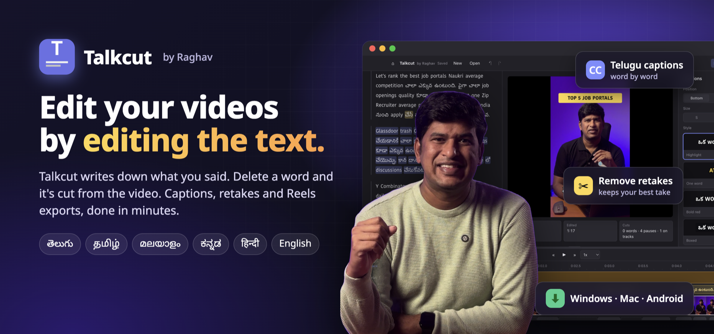
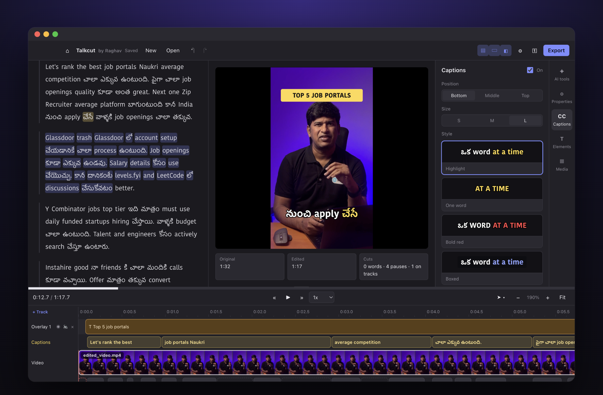
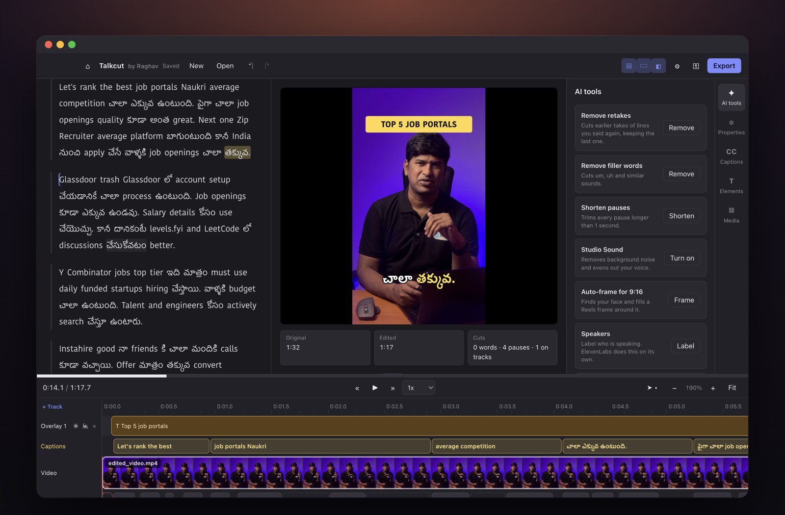
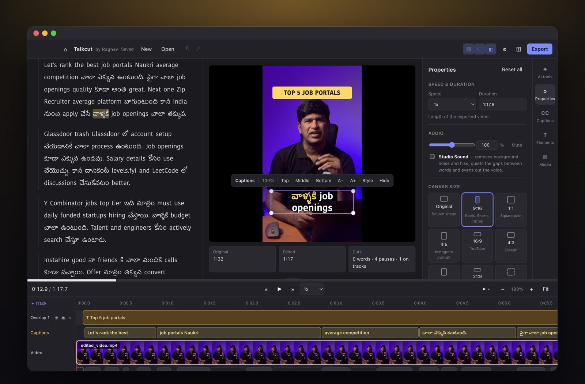
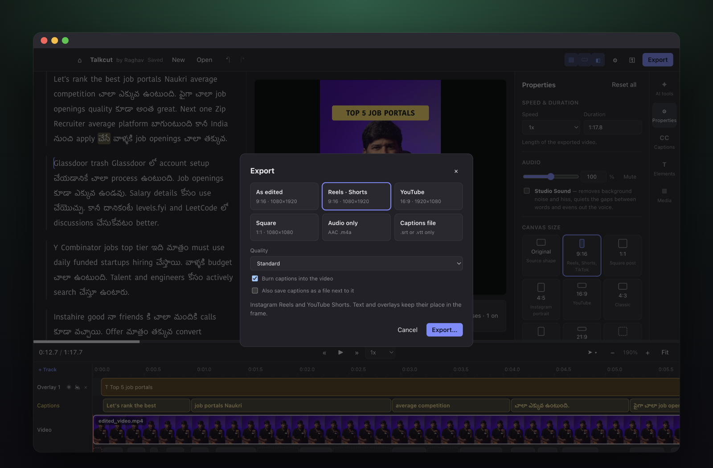
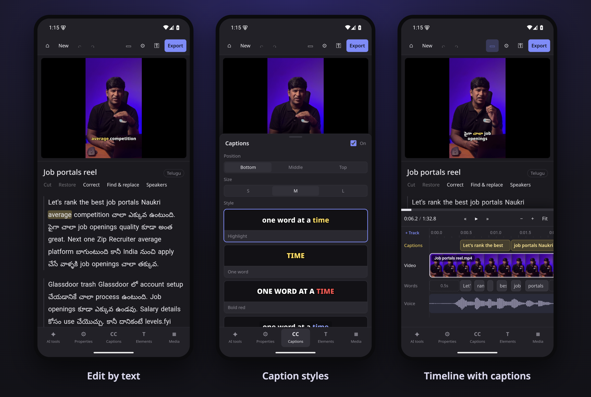

<p align="center">
  
</p>

<p align="center">
  <a href="https://github.com/raghavsunil99/talkcut/releases/latest"></a>
  
  
  
</p>

<p align="center">
  <b>Talkcut writes down what you said. Delete words in the text, and they're cut from the video.</b><br>
  Made for Telugu, Tamil, Malayalam, Kannada, Hindi and English creators, including everyday mixed speech like Telugu with English words.
</p>

<p align="center">
  <a href="#-download">Download</a> ·
  <a href="#-features">Features</a> ·
  <a href="#-on-android">Android</a> ·
  <a href="#-languages">Languages</a> ·
  <a href="#build-from-source">Build from source</a>
</p>

<p align="center">
  
</p>

## ⬇ Download

| Device | File | Notes |
|---|---|---|
| 🪟 **Windows** 10/11 (64-bit) | [Talkcut-by-Raghav-Setup-1.0.2.exe](https://github.com/raghavsunil99/talkcut/releases/latest) | If "Windows protected your PC" appears, click **More info → Run anyway** |
| 🍎 **Mac** with Apple silicon (M1 or newer) | [Talkcut-by-Raghav-1.0.2-mac-arm64.dmg](https://github.com/raghavsunil99/talkcut/releases/latest) | Drag to Applications, then **System Settings → Privacy & Security → Open Anyway** once |
| 🤖 **Android** 6+ phone or tablet | [Talkcut-by-Raghav-1.0.2.apk](https://github.com/raghavsunil99/talkcut/releases/latest) | Allow installing from your browser or Files app, then **Install anyway** |

Step-by-step instructions: [HOW TO INSTALL TALKCUT.txt](build/HOW%20TO%20INSTALL%20TALKCUT.txt)

## ✨ Features

<table>
<tr>
<td width="50%" valign="top">

### ✂️ Edit like a document
Cut words, pauses and whole sentences from the transcript. Fix spellings for the captions without touching the video, and find & replace mistakes everywhere at once, with a word list for names and brands.

</td>
<td width="50%" valign="top">

### ✦ AI tools
**Remove retakes** (keeps your last take), **remove filler words**, **shorten pauses**, **Studio Sound** voice cleanup, **auto-frame** your face for 9:16, and **speaker labels**.

</td>
</tr>
<tr>
<td></td>
<td></td>
</tr>
<tr>
<td width="50%" valign="top">

### 💬 Captions that pop
Six styles with a word-by-word highlight. Drag and resize them right on the video, see them as a row on the timeline, and export SRT/VTT files for YouTube.

</td>
<td width="50%" valign="top">

### 🎞 A real timeline
B-roll, photos, titles and text on overlay tracks; music that turns down while you speak; blade, range and slip tools; undo for everything.

</td>
</tr>
<tr>
<td colspan="2"></td>
</tr>
<tr>
<td width="50%" valign="top">

### 📐 Any frame
9:16, 1:1, 4:5, 16:9, 4:3 or a custom size; blurred background instead of black bars; crop on the video with shape presets; rotate and flip.

</td>
<td width="50%" valign="top">

### 🚀 Ready to post
Export presets for Reels / Shorts, YouTube and square posts, with captions burned in. Projects save automatically.

</td>
</tr>
</table>

<p align="center"><sub>Dark, Midnight and Light themes, six accent colours, and four workspace layouts.</sub></p>

## 📱 On Android

The same editor, laid out for a phone. Export makes the video on the phone and opens the share menu, so it can go straight to Instagram, WhatsApp or Photos.

<p align="center">
  
</p>

## 🗣 Languages

Telugu · Tamil · Malayalam · Kannada · Hindi · Marathi · Bengali · English · Spanish · French · German

| | Windows & Mac | Android |
|---|---|---|
| **Free, on your device** | ✅ Fast and Accurate engines (whisper.cpp) | — |
| **ElevenLabs** (your own key) | ✅ Best for Telugu, Tamil and Malayalam; tells speakers apart | ✅ |

No API keys are bundled. Each person adds their own, and they're stored only on their device.

---

## Build from source

The rest of this page is for developers.

## Run

```bash
npm install
npm run build:whisper
npm start
```

`build:whisper` compiles [whisper.cpp](https://github.com/ggml-org/whisper.cpp) v1.7.6 with Metal into `vendor/`. It needs Xcode Command Line Tools (`xcode-select --install`); if CMake is missing it installs it into `vendor/cmake-venv`.

You can also pass a file: `npm start -- ~/Movies/clip.mp4`.

Speech models download on first use into the app's data folder (`~/Library/Application Support/cutline/models/ggml` when run from source): `large-v3-turbo` (about 570 MB) for **Fast**, `large-v3` (about 1.1 GB) for **Accurate** and for language auto-detection. After that everything runs offline.

## Features in detail

- **Language** (toolbar): *Auto-detect* listens to a few parts of the recording and picks the language; speech that mixes a language with English (Telugu and English, for example) is written in that language's script with English words kept in English. You can also pick the language yourself.
- **Quality**: *Fast* suits most recordings. *Accurate* is noticeably better for Indian languages but slower. *Cloud · ElevenLabs* sends the audio to ElevenLabs Scribe instead: on a Telugu–English test clip it had 3% word errors against Descript's transcript, versus about 70% for Accurate. It uses your ElevenLabs credit and needs an ElevenLabs API key.
- **API keys** (⚿ in the toolbar, or File → API Keys…, ⇧⌘K): save several named ElevenLabs and Pexels keys, pick which one is active, rename (double-click the name) or remove them. Keys are stored encrypted with the macOS keychain and only their last four characters are ever shown.
- **Open media** (⌘O) or drop a file on the window: audio or video (mp4, mov, mkv, webm, mp3, wav, m4a, flac and more).
- **Edit the transcript like a document**: click to place the cursor, **⌫** / **Delete** cut the word before / after it, drag or **⇧-click** (or **⇧←/⇧→**) to select and **⌫** to cut. Cut words disappear from the text and the video; the small ⌁ marker left in their place shows what was cut, and clicking it brings them back.
- **Correct spelling** without changing the video: double-click a word, press **Enter** on a selection, or just start typing over it. Enter saves, Esc cancels.
- **Timeline** (bottom): ruler, filmstrip, word blocks, pause blocks and waveform, laid out as the edited result. Click to seek, click a word block to select it, click a pause block (for example `1.2s`) and press **⌫** to shorten it to 0.2 s. ⌘-scroll or **− / +** zooms; **Fit** shows the whole edit.
- **Remove fillers** (⇧⌘F) cuts "um", "uh" and similar words. **Shorten pauses** (⇧⌘P) shortens every pause longer than a second.
- **Captions** (right sidebar, CC): turn them on, pick a style (Highlight, One word, Bold red, Boxed, Clean, Subtitle), position and size. They follow the speech word by word in the preview and are burned into the exported video. Telugu, Hindi, Bangla, Kannada, Tamil and Malayalam use matching macOS fonts.
- **Media** (right sidebar): *My media* adds your own videos or photos; *Stock* searches free Pexels videos and photos (needs a free API key from [pexels.com/api](https://www.pexels.com/api/), stored encrypted in the macOS keychain). Clicking an item lays it over the picture at the playhead as B-roll while the voice keeps playing. On the B-roll track, drag a block to move it, drag its right edge to change its length, or select it and press ⌫ to remove it.
- **Properties** (right sidebar): speed and duration (type a length to fit the speed to it), audio volume up to 200% and mute, frame shape (Original, 9:16, 1:1, 4:5, 16:9) and background colour, scale, X/Y position, 90° rotation, and crop on each side. The preview shows exactly what the export will be; ⌘Z undoes changes.
- **Timeline tools** (tool menu next to zoom, or the keys): **Select** (A) words, pauses, B-roll and blade pieces; **Hand** (H) drag to scroll; **Blade** (B) click to split the clip, then select a piece and press ⌫; **Range** (R) drag across any stretch, even mid-word, and press ⌫; **Slip** (Y) drag a B-roll video to change which part of it plays.
- **API keys**: + Add API key (choose ElevenLabs or Pexels), name, note, on/off switch per key. If the ElevenLabs key in use runs out of credits, Talkcut asks before switching to the next enabled key and trying again.
- **Playback**: «/» jump 5 s, speed from 0.75x to 2x, and the bar above the timeline scrubs through the whole edit.
- **Undo / Redo**: ⌘Z / ⇧⌘Z.
- **Save** (⌘S) writes a `.talkcut` project file (transcript, language, cuts and tracks) to Documents › Talkcut Projects. **Open project** reopens it without transcribing again.
- **Export** (⌘E) renders an MP4 (video) or M4A/WAV/MP3 (audio). Your original file is never changed.

## Test

```bash
npm test
```

## Layout

- `src/main.js`: window, menus, dialogs and the IPC handlers
- `src/transcribe.js`: splits audio at pauses, detects the language, runs whisper.cpp and turns its output into timed words
- `src/media.js`: FFmpeg probing, decoding, pause detection, waveform peaks, thumbnails and export rendering
- `src/preload.js`: the small API the page is allowed to call
- `src/stock.js`: Pexels search and download
- `src/renderer/`: the editor page; `edits.js` holds the pure cut and time-mapping logic, `captions.js` caption styles and the ASS subtitle writer (shared with export), `timeline.js` the timeline panel, `panels.js` the Captions and Media sidebar
- `scripts/build-whisper.sh`: builds the whisper.cpp engine

## Notes

- Recordings are cut at their quietest moments into clips of at most 8 seconds, transcribed independently. In longer windows Whisper drops repeated takes and late phrases, and on code-mixed speech one bad stretch can swallow the rest; short clips avoid both.
- A second pass finds speech that still has no words and transcribes just those stretches again without the style prompt, falling back to the Accurate model when Fast returns nothing (it does for some Telugu).
- Word times come from whisper.cpp's DTW alignment (`--dtw`), shifted back from each clip to the original timeline.
- For Indian languages Whisper is given a short code-mixed example sentence, so English words come out in English letters ("account setup చేయడానికి") as people write them, instead of in the native script.
- Telugu accuracy is far from perfect: spellings are often approximate and an occasional phrase is dropped. Whisper's Telugu is much weaker than its English; a cloud speech service would do better if that matters more than keeping everything on this Mac.
- Whisper tends to leave out "um" and "uh", so filler removal only catches the ones it writes down.

## Mac app

`npm run dist:mac` builds `dist/Talkcut-by-Raghav-<version>-mac-arm64.dmg` (Apple silicon, macOS 13+), ad-hoc signed by `build/afterPack.js`, with ffmpeg, whisper-cli and the face finder bundled.

## Windows installer

`npm run dist:win` builds `dist/Talkcut-by-Raghav-Setup-<version>.exe` (64-bit, NSIS) on a Mac.

One-time setup on an Apple-silicon Mac (electron-builder's bundled NSIS and Wine are Intel-only):

1. `brew install makensis`
2. Make `~/Library/Caches/cutline-nsis-3.13` from Homebrew's `share/nsis` (Contrib, Include,
   Plugins, Stubs, nsisconf.nsh), plus `elevate.exe` from electron-builder's NSIS cache and
   `mac/makensis` linked to `/opt/homebrew/bin/makensis`.
3. Put the Windows binaries in `vendor/win/` (not in git):
   - `bin/ffmpeg.exe` — ffmpeg-static b6.1.1 `ffmpeg-win32-x64`
   - `whisper/` — `whisper-cli.exe` and its DLLs from whisper.cpp v1.7.6 `whisper-blas-bin-x64.zip`
   - `vc_redist.x64.exe` — Microsoft Visual C++ runtime (the installer runs it if missing)
   - `ffmpeg.LICENSE`

`build/afterPack.js` writes the icon and version details into the Windows .exe (rcedit would need Wine).
`build/HOW TO INSTALL TALKCUT.txt` is the guide for people installing it.

On Windows, transcription runs on the CPU (slower than on a Mac), Auto-frame is hidden
(it uses macOS Vision), and captions use Nirmala UI / Segoe UI.

## Android app

`npm run dist:android` builds `android/app/build/outputs/apk/release/app-release.apk`.

- The editor in `src/renderer` runs inside Capacitor. `mobile/bridge.js` stands in for the
  desktop back end: IndexedDB for projects and videos, ElevenLabs for transcription, and
  ffmpeg.wasm running the same export recipe (`src/renderer/render-plan.js`). Finished videos
  are saved to Documents/Talkcut and offered to the share sheet.
- `mobile/mobile.css` is the phone layout, `mobile/touch.js` turns finger drags into the mouse
  events the editor uses, and `mobile/fonts` holds Noto fonts (OFL) for the caption scripts.
- `scripts/build-android-web.js` assembles `mobile/www` (not in git) for Capacitor.
- Needs JDK 21 (`brew install openjdk@21`) and the Android SDK (`android/local.properties`).
- Release signing key: `android-signing/` (not in git). Keep it: updates must use the same key.
